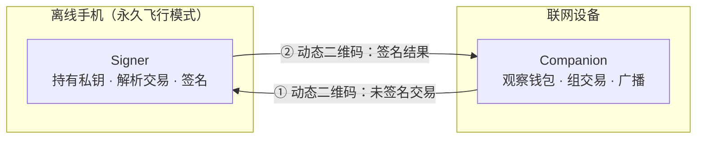

# CamWallet

> 把任何一台有摄像头和浏览器的旧手机，变成一台离线签名器。
> 不需要专用硬件，不需要数据线，不需要蓝牙、NFC 或网络——只需要一块屏幕和一个摄像头。

**状态：设计阶段。尚无可用代码，尚未经过任何安全审计。不要用它保管真实资产。**

---

## 这是什么

CamWallet 由两部分组成，它们之间**只通过二维码通信**，没有任何其他信道：

- **Signer（离线端）**：安装在一台永久断网的旧手机上。它持有或恢复私钥、解析待签名交易、产生签名。它从不发起任何网络请求。
- **Companion（在线端）**：跑在你的日常设备上。它是一个观察钱包——查询余额、构造未签名交易、把签好的交易广播出去。它永远接触不到私钥。



两台设备物理隔离。摄像头拍屏幕是唯一的数据通路，肉眼可见、带宽极低、无法被远程利用。

---

## 这不是什么

- **不是一个"更安全"的热钱包。** 如果 Signer 所在的设备联过网，本项目提供的安全性趋近于零。
- **不是硬件钱包的替代品。** 手机没有安全元件（Secure Element），无法抵抗有资源的物理攻击者。丢了手机 ≠ 安全，丢了助记词 = 一定完蛋。
- **不是资产管理工具。** Signer 不显示余额、不联网、不知道链上发生了什么。

---

## 设计决策

### 为什么是 PWA，而不是原生 App

目标是"任何一台旧手机都能用"，而不是"任何一台旧手机都能装 APK"。旧 Android 的 API 等级、签名校验、侧载体验差异巨大，iOS 更是基本无法侧载。浏览器是唯一在所有旧设备上都存在的运行时。

代价必须说清楚。选 PWA 意味着我们主动放弃了几件事：

| 放弃的能力 | 原因 | 我们的应对 |
|---|---|---|
| 用系统密钥库 / Secure Enclave 保护密钥 | 浏览器无法访问 Android Keystore 或 iOS Secure Enclave | 不持久化密钥（见下方无状态设计） |
| 通过安装包哈希验证代码完整性 | 网页代码由服务器每次下发 | 可复现构建 + 发布产物哈希 + 安装后离线运行，用户可在安装前校验 |
| 擦除内存中的密钥 | JavaScript 有 GC，字符串不可变 | 缩短密钥在内存中的存活时间，签完即释放引用 |

**重要**：`file://` 打开的本地 HTML 无法访问摄像头（Chrome 对 `file://` 的 `getUserMedia` 静默阻断）。因此"下载一个 HTML 文件离线打开"的方案不可行。Signer 必须以 PWA 形式安装到主屏，之后才能在完全离线的状态下访问摄像头。

安装流程因此是一次性的、需要联网的，也是整个系统信任的起点：

1. 在离线手机上，联网访问一次官方地址，安装 PWA 到主屏
2. 在应用内校验显示的构建哈希，与 GitHub Release 中的可复现构建产物比对
3. 开启飞行模式，此后永不联网

### 无状态：私钥永不落盘

Signer **不在任何地方持久化私钥或助记词**。密钥只存在于内存中，每次使用时从助记词恢复，关闭页面即消失。

这不是妥协，而是主动选择，理由有三：

1. **浏览器存储本来就不可靠。** Safari 的 ITP 会在 7 天无用户交互后删除该 origin 下的全部脚本可写存储——IndexedDB、LocalStorage、SessionStorage，连 service worker 的注册和缓存一起删。加到主屏的 PWA 有独立的使用计数器可以豁免，但这是厂商的行为承诺而非技术保证，而冷钱包可能几个月才用一次。任何依赖浏览器存储保管私钥的设计都是在赌博。
2. **无状态消除了整类风险。** 手机被偷、被卖、被拆、被取证——设备上没有任何秘密可提取。安全边界收敛到你的纸/钢备份，那是一个你能理解、能物理控制的东西。
3. **它跟 air-gap 模型是自洽的。** 助记词的离线备份本来就是必须的。既然备份必须存在，设备上再存一份只是增加攻击面。

代价是每次签名都要重新输入助记词。我们会通过 SeedQR（把助记词编码成二维码，扫描导入）来降低这个摩擦，但这个二维码本身就等价于私钥，只应该用在离线设备之间。

### 密钥生成：不信任单一熵源

弱随机数是这个领域最常见也最致命的失败模式，而且从未停止发生：Android 在 2013 年因 `SecureRandom` 实现缺陷导致比特币被盗；2026 年 Coldcard 被发现因一个编译宏判断错误（检查宏"是否定义"而非"是否启用"），固件静默绕过硬件随机数发生器、退回到确定性 PRNG，把 128 bit 熵降至约 40 bit，损失超过一亿美元——而它的源码全程公开。

浏览器环境更糟：`crypto.getRandomValues()` 完全依赖操作系统熵池，而刚开机的旧手机、移动浏览器沙箱恰恰是熵池最贫瘠的场景。

因此 CamWallet 的密钥生成**必须混合多个独立熵源**，且任何单一源失效都不降低整体强度：

- 用户手动熵：骰子点数或抛硬币序列（可选但强烈推荐，且是唯一你能亲自验证的源）
- 摄像头噪声：传感器暗电流采样
- 设备运动传感器（在可用时）
- `crypto.getRandomValues()`

所有源经 HKDF 混合。整个熵路径必须可以在界面上展示和自查——Coldcard 事件的教训正是"审计者确认了硬件 RNG 存在，却没人验证生成种子的代码路径真的调用了它"。

### 签名：确定性 nonce，且可被外部验证

摄像头和屏幕是**双向**信道，不是单向的。一个被植入后门的签名器不需要网络就能外泄密钥——它可以把私钥的比特编码进 ECDSA 的 nonce（kleptography）。这样产生的签名完全合法、验证完全通过，但攻击者在观察到若干笔交易后即可恢复私钥。

对策是使用 RFC 6979（ECDSA）/ RFC 8032（Ed25519）的确定性 nonce，并且让 Companion 端**能独立重算并验证**签名确实是确定性产生的。这一验证能力是本项目的核心特性，不是可选项。

### 交易解析：看得懂再签

**冷钱包保护的是私钥，不是你的钱。** 用户在小屏上看到一串无法理解的 calldata，点了确认，把代币的无限额度授权给了攻击者——私钥一个比特都没泄漏，钱照样没了。这是当前实际资金损失的主要来源，也是现有 air-gap 方案普遍最薄弱的环节。

Signer 必须在完全离线的条件下，把待签内容还原成人能读懂的东西：

- 接收方地址、金额、手续费的醒目展示，地址做分段高亮以便逐字核对
- 内置离线 ABI 库，解码常见合约调用；无法解码时**明确警告用户这是盲签**，而不是默默展示一串十六进制
- EIP-712 结构化数据按字段展示
- 对 `approve` / `setApprovalForAll` 等授权类操作，以及无限额度，给出强提示
- 找零地址与派生路径的校验展示（多签场景尤其关键）

---

## 互操作

我们**不发明新的二维码协议**。自定义协议等于把自己排除在生态之外，没有任何在线钱包会来适配。

CamWallet 遵循已有标准：

- **BC-UR 2.0**（Blockchain Commons Uniform Resources）：基于 CBOR 的自描述编码，用 Luby transform 喷泉码把大数据切分为动态二维码帧序列，容忍丢帧、乱序、从任意帧开始扫描
- **`ur:crypto-psbt`**：比特币 PSBT 传输
- **EIP-4527**：以太坊的 `eth-sign-request` / `eth-signature`
- **SeedQR**：助记词的二维码编码

目标是让 Sparrow、Specter、BlueWallet、MetaMask 等钱包可以直接把 CamWallet 当作硬件钱包接入，用户不必安装我们的 Companion。

---

## 架构

```
packages/
  core/          纯函数、无 I/O、无平台依赖：BIP-32/39、签名、UR 编解码
  chains/        可插拔链适配器，统一接口
    bitcoin/       PSBT 构造与签名
    evm/           交易与 EIP-712 签名、calldata 解码
  ui/            共享组件：摄像头扫描、动态二维码渲染、交易展示
  signer/        离线端 PWA
  companion/     在线端网页（观察钱包）
```

链适配器统一暴露：派生账户、解析待签载荷、渲染为可读结构、签名、编码回 UR。新增一条链只需实现这个接口，不触碰核心与 UI。

---

## 与现有方案的关系

这个领域已有成熟方案，CamWallet 不假装自己是首创：

| 项目 | 形态 | 与本项目的关系 |
|---|---|---|
| [AirGap Vault](https://github.com/airgap-it/airgap-vault) | 原生 App，开源 | 同一思路的成熟实现，多链，密钥存于 secure enclave。对旧机型兼容性有限 |
| [Polkadot Vault](https://github.com/paritytech/parity-signer)（原 Parity Signer） | 原生 App，开源 | 同一思路，专注 Substrate 生态 |
| [SeedSigner](https://seedsigner.com/) | DIY 硬件，约 $50 | 无状态设计的来源，纯二维码，仅比特币 |
| [Krux](https://selfcustody.github.io/krux/) | K210 开发板固件 | 无状态，支持 microSD 与二维码 |
| [Keystone 3 Pro](https://keyst.one/) | 商业硬件 | 纯二维码通信，三安全元件，USB 仅供充电 |

CamWallet 试图填补的空隙：

1. **零硬件门槛**：不需要买设备，不需要侧载 APK，一台能开浏览器的旧手机即可
2. **极低配兼容**：明确针对老旧摄像头与低分辨率屏幕优化动态二维码的鲁棒性（自适应帧率、码密度、纠错等级）——这是现有方案用户抱怨最集中的地方
3. **交易可读性优先**：把"看得懂再签"作为第一目标而非附加功能

---

## 路线图

- [ ] **M0 — 打通闭环**：单链（比特币 PSBT），生成密钥 → 显示二维码 → 扫描 → 签名 → 回传，跑通一次 testnet 交易
- [ ] **M1 — 标准互通**：完整 BC-UR 2.0 实现，能被 Sparrow 直接当硬件钱包接入
- [ ] **M2 — 离线化**：PWA 打包、service worker 离线运行、构建哈希自校验、零外部请求 CSP
- [ ] **M3 — 熵与无状态**：多源熵混合与可视化、SeedQR 导入导出、确定性 nonce 与外部可验证性
- [ ] **M4 — EVM 适配器**：EIP-4527、EIP-712 展示、离线 ABI 解码库
- [ ] **M5 — 鲁棒性**：老旧摄像头适配、自适应二维码参数、在真实旧机型上的兼容性矩阵
- [ ] **M6 — 可复现构建与外部审计**

---

## 威胁模型

诚实地说明防什么、不防什么，比任何安全特性都重要。

### 能防御

- 联网设备上的恶意软件、剪贴板劫持、远程代码执行
- 针对在线钱包的钓鱼与供应链攻击（Companion 不持有密钥）
- USB / 蓝牙 / NFC 相关的整类攻击面（不存在这些信道）
- 硬件钱包的物流环节掉包（用你自己的旧手机）

### 不能防御

- **安装时被投毒的代码。** 这是本方案最大的残余风险。安装是一次性的联网行为，若此时下发的代码已被篡改，一切安全设计失效。缓解手段是可复现构建与哈希校验，但这要求用户真的去核对。
- **本就不干净的设备。** 二手手机、被改过的厂商 ROM、预装应用、被篡改的 bootloader。恢复出厂设置清不掉底层固件。
- **浏览器本身。** 它是一个庞大、不透明、持续更新的攻击面，且不受我们控制。
- **物理攻击者。** 无安全元件、无防拆自毁。设备被物理控制即视为失守——这正是坚持无状态设计的原因。
- **用户被骗签署了合法但有害的交易。** 我们只能通过交易解析尽力降低概率，无法根除。
- **备份丢失。** 助记词丢了，资产就没了，没有任何找回途径。

---

## 免责声明

本项目处于早期设计阶段，代码未完成、未经审计。加密货币自托管的一切风险由使用者自行承担。在项目明确宣布经过独立安全审计之前，**请仅在测试网使用，或仅用于学习目的**。

## 许可

[Apache License 2.0](LICENSE)
